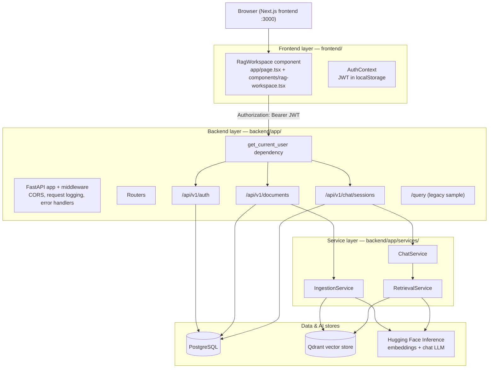
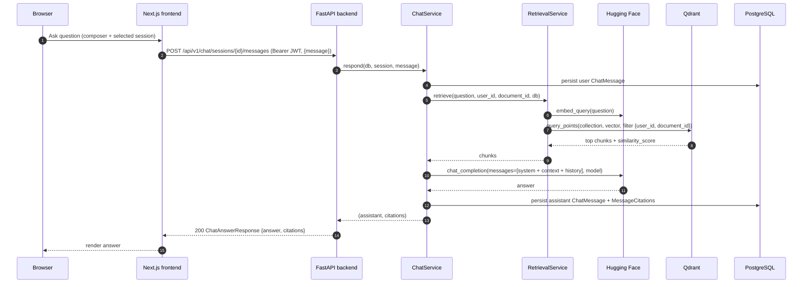
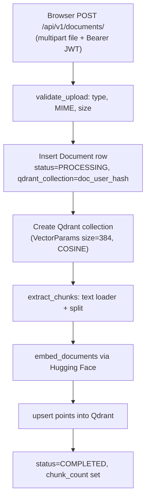
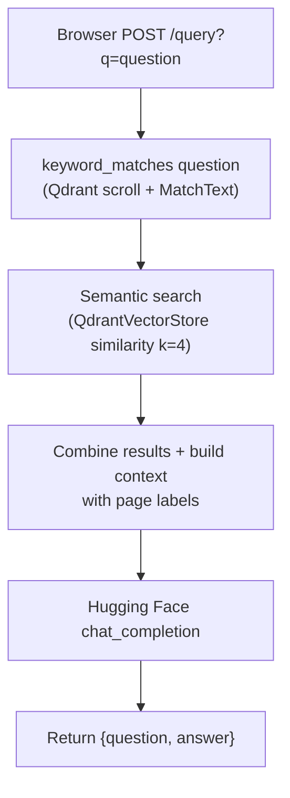

# RAG Platform

A full-stack, authenticated RAG application. The FastAPI backend owns authentication, PostgreSQL data, Qdrant retrieval, and citation persistence; the Next.js frontend uses only the protected `/api/v1` API.

```text
Browser (frontend:3000) -> FastAPI (backend:8000) -> PostgreSQL
                                                -> Qdrant -> embedding model / LLM
```

## Architecture

### System flowchart



### Layer summary

#### 1. Frontend layer — `frontend/`

Next.js (App Router) user interface.

- `app/layout.tsx` wraps the app in the `AuthProvider`; `app/page.tsx` renders the `RagWorkspace`.
- `components/rag-workspace.tsx` implements the UI: auth modal, sidebar (documents / sessions), upload dialog, question composer, and answer panel.
- `src/context/AuthContext.tsx` keeps the JWT in browser local storage, verifies it through `/api/v1/auth/me`, and exposes `authFetch`, which attaches the `Authorization: Bearer <token>` header to every API call.

Responsibility: authentication UI state and calling the protected `/api/v1` endpoints (documents and chat). It does not talk to PostgreSQL or Qdrant directly.

#### 2. API layer — `backend/app/`

FastAPI application that exposes the HTTP surface.

- `app/main.py`: creates the FastAPI app, adds CORS middleware and an HTTP middleware that logs a request id and latency, maps `OperationalError` to `503 DATABASE_UNAVAILABLE` and unexpected errors to `500`.
- Routers: `/api/v1/auth`, `/api/v1/documents`, `/api/v1/chat/sessions`, plus the legacy `/query` router from `app/routes/query.py`.
- `app/api/deps.py`: `get_current_user` dependency — extracts the bearer token, decodes the JWT, loads the user from the database and rejects invalid/inactive users with `401`.

Responsibility: HTTP concerns, request validation via Pydantic schemas, dependency injection of the current user, and orchestration between the service layer.

#### 3. Service layer — `backend/app/services/`

Where most of the RAG logic lives.

- `ingestion_service.py` — `validate_upload` (allowed types `.pdf`/`.txt`/`.docx`, MIME type check, size limit), `extract_chunks` (text extraction per file type + `RecursiveCharacterTextSplitter`) and `ingest` (embed chunks via Hugging Face, create the per-document Qdrant collection, upsert points with payloads including `document_id`, `user_id`, `filename`, `chunk_id`, `page_number` and `source_text`).
- `retrieval_service.py` — `retrieve` embeds the question, resolves the correct Qdrant collection (per-document `doc_<user_id>_<hash>` or the default collection) and runs a filtered similarity search, returning chunks with their similarity score.
- `chat_service.py` — `respond` persists the user message, retrieves relevant chunks, builds the RAG context with source labels, loads recent chat history (last `max_chat_history` messages), calls the chat completion model, then persists the assistant answer and its citations.

#### 4. RAG components

- **Embedding + chat models** via the Hugging Face Inference API (`huggingface_hub.InferenceClient`): embedding model `sentence-transformers/all-MiniLM-L6-v2`, chat model `meta-llama/Llama-3.1-8B-Instruct`.
- **Vector store**: Qdrant (`qdrant_client`), collections created with `VectorParams(size=384, distance=COSINE)`.
- **Framework glue**: LangChain pieces (`QdrantVectorStore`, `Embeddings`, `RecursiveCharacterTextSplitter`, `PyPDFLoader`).

#### 5. Data layer — `backend/app/db/` and `backend/alembic/`

- SQLAlchemy models: `User`, `Document`, `ChatSession`, `ChatMessage`, `MessageCitation` (PostgreSQL dialect UUID columns).
- Alembic migrations: `0001_initial_schema` and `0002_add_doc_id_to_sess`.

## End-to-end flow

### Ask a question (RAG chat)

Sequence of the main chat flow:



Step-by-step:

1. The user types a question in the frontend and sends it to `POST /api/v1/chat/sessions/{session_id}/messages`.
2. The backend loads the chat session and verifies it belongs to the current user (404 otherwise).
3. `ChatService.respond` persists the user message, then calls `RetrievalService.retrieve`.
4. The question is embedded with the Hugging Face embedding model and sent to Qdrant, filtered by `user_id` and `document_id`, returning the top chunks with similarity scores.
5. The retrieved chunks are formatted into the RAG context (with source labels such as `[Source 1: filename, page N]`), combined with the recent chat history, and passed to the Hugging Face chat completion model.
6. The answer is persisted as an assistant `ChatMessage` together with `MessageCitation` rows, then returned to the frontend.
7. The frontend renders the answer and shows the citations.

### Upload and ingestion flow



### Legacy `/query` flow



## Evaluation layer

The backend ships a first-class RAG evaluation toolkit under `backend/app/evaluation/`.

- `dataset.py` — evaluation record schema (`EvalRecord`) and JSONL loading/validation.
- `retrieval_metrics.py` — Recall@K, Precision@K, Hit Rate@K, MRR, and retrieval evaluation.
- `answer_metrics.py` — normalized exact match and token-overlap answer metrics.
- `runner.py` — retrieval and end-to-end evaluation orchestration, plus CLI entry.
- `generate_dataset.py` — AI-assisted candidate generation from source chunks.
- `datasets/` — candidate and golden JSONL datasets.

Run the retrieval evaluation:

```powershell
cd backend
python -m app.evaluation.runner --dataset app/evaluation/datasets/golden_dataset.jsonl --k 5
```

The initial benchmark uses the reviewed golden dataset at `backend/app/evaluation/datasets/golden_dataset.jsonl`. Retrieval and answer metrics are reported separately, and unanswerable cases are excluded from retrieval aggregates.

## Repository layout

```text
backend/       FastAPI app, Alembic migrations, tests, Python dependencies
frontend/      Next.js user interface and its container build
.github/       Independent backend and frontend CI workflows
```

## Run the platform

```powershell
Copy-Item .env.example .env
# Set JWT_SECRET_KEY and HF_TOKEN in .env
docker compose up --build
```

Open `http://localhost:3000`, create an account, upload a PDF/TXT/DOCX document, create a chat, and ask questions. API documentation is at `http://localhost:8000/docs`.

For a browser database view during local development, open `http://localhost:8080` after `docker compose up`. In Adminer use `PostgreSQL`, server `postgres`, username `postgres`, password `postgres`, and database `rag_app`. Browse tables such as `users`, `documents`, `chat_sessions`, `chat_messages`, and `message_citations`. Adminer is intended for local development only.

For local backend work:

```powershell
cd backend
pip install -r requirements.txt -r requirements-huggingface.txt -r requirements-production.txt
alembic upgrade head
uvicorn app.main:app --reload
```

For local frontend work:

```powershell
cd frontend
pnpm install
$env:NEXT_PUBLIC_RAG_API_URL = 'http://localhost:8000'
pnpm dev
```

## Integration contract

The frontend authenticates using `/api/v1/auth/register` and `/api/v1/auth/login`, keeps the bearer token in browser local storage, and sends it for every document and chat request. It uses `/api/v1/documents`, `/api/v1/chat/sessions`, and `/api/v1/chat/sessions/{id}/messages`; it does not use the legacy sample `/query` route. CORS is configured through `CORS_ORIGINS` in `.env`.

Run backend tests with `cd backend; python -m pytest tests -q -p no:cacheprovider`, and build the frontend with `cd frontend; pnpm build`.
